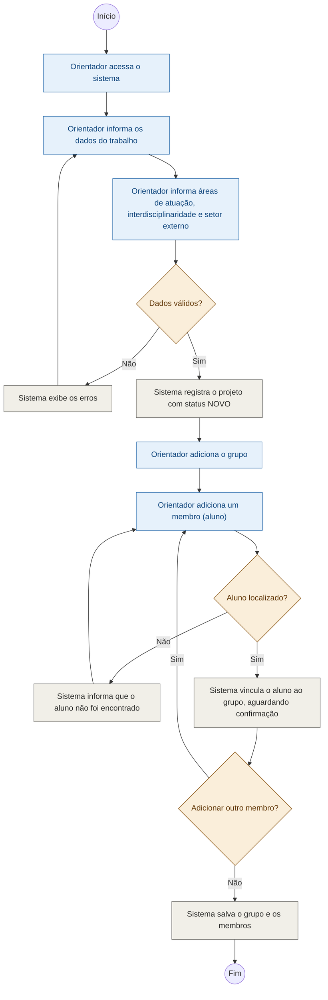
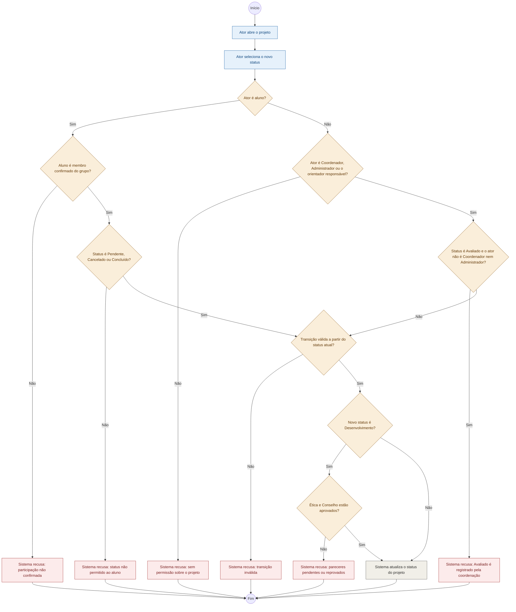
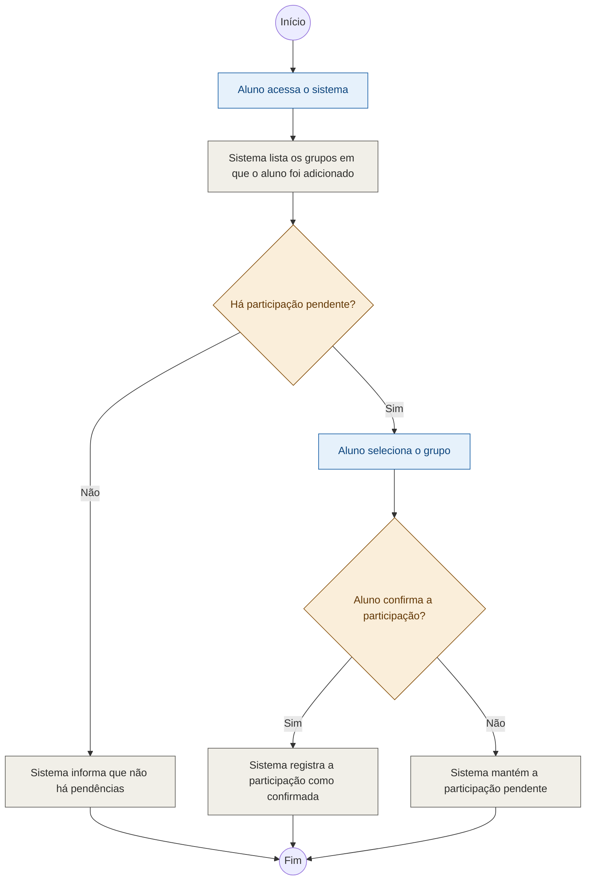
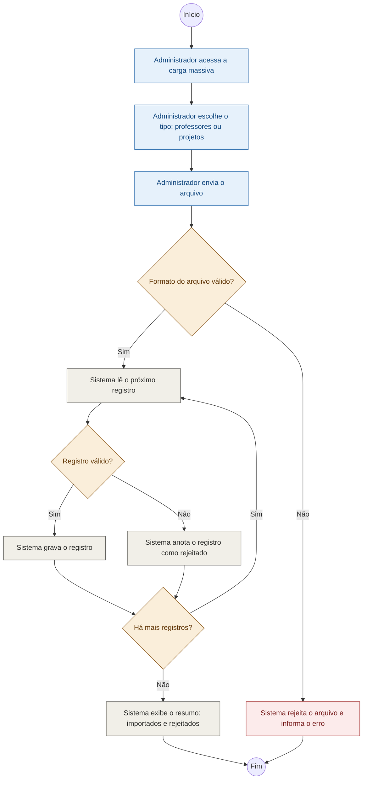
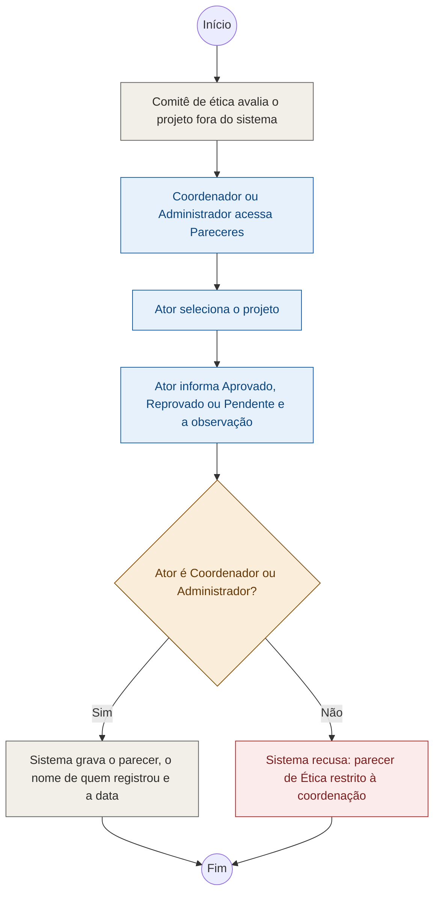
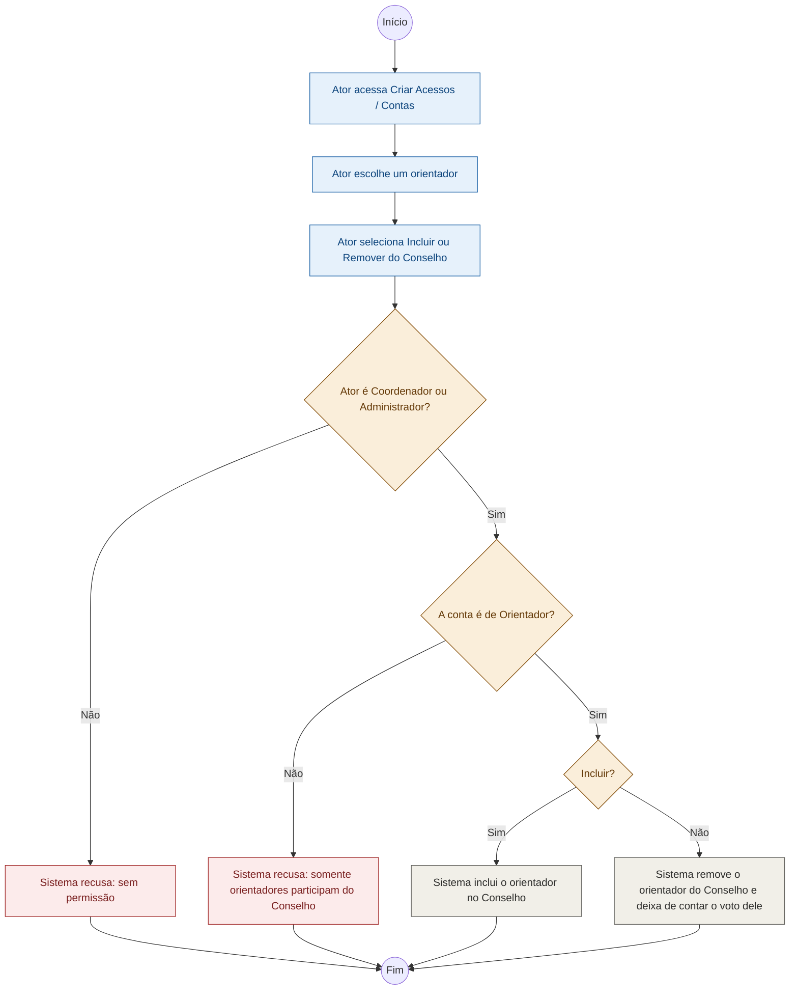
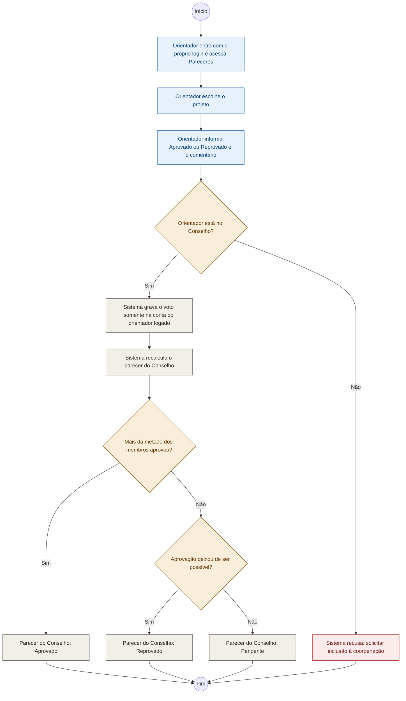
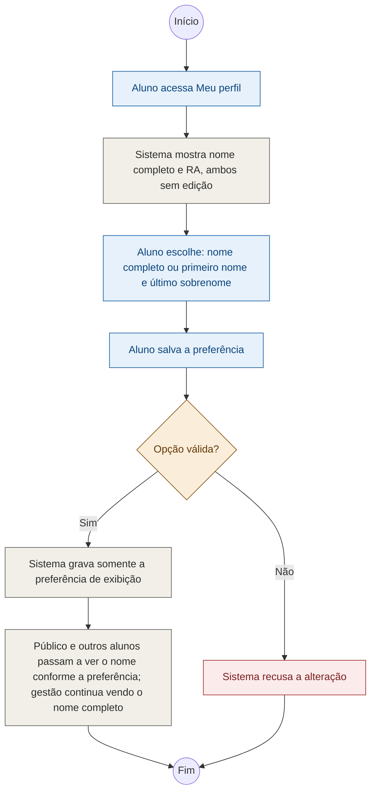
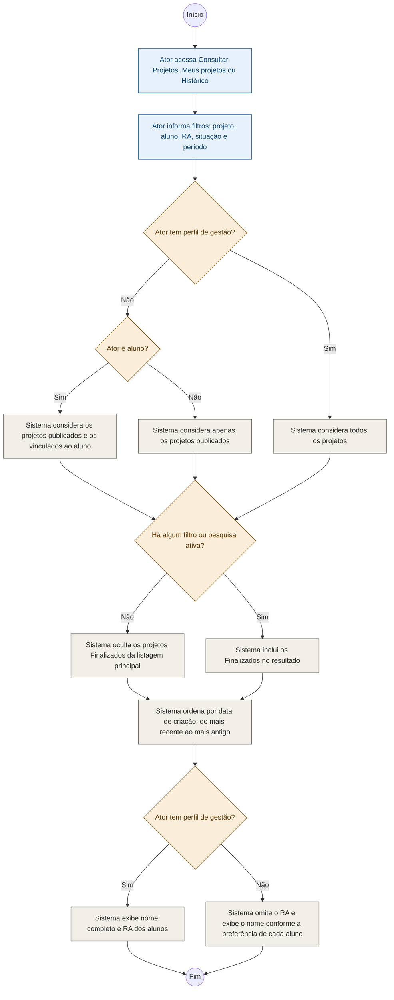

# Diagramas de Atividade: Módulo 2 Controle (Registro)

Legenda de cores: azul = ação do ator; cinza = ação do sistema; amarelo = decisão; vermelho = recusa/erro.

## 1. Registrar trabalho, grupo e membros

Ator: Orientador. Imagem: [01-registrar-trabalho-grupo-membros.png](01-registrar-trabalho-grupo-membros.png)

## 2. Realizar status (andamento)

Ator: Orientador, Coordenador, Administrador e Aluno. Imagem: [02-realizar-status-andamento.png](02-realizar-status-andamento.png)

## 3. Confirmar participação no grupo

Ator: Aluno. Imagem: [03-confirmar-participacao-grupo.png](03-confirmar-participacao-grupo.png)

## 4. Carga massiva (professores ou projetos)

Ator: Administrador. Imagem: [04-carga-massiva.png](04-carga-massiva.png)

## 5. Registrar parecer de Ética

Ator: Coordenador e Administrador. Imagem: [05-registrar-parecer-etica.png](05-registrar-parecer-etica.png)

## 6. Definir membros do Conselho

Ator: Coordenador e Administrador. Imagem: [06-definir-membros-conselho.png](06-definir-membros-conselho.png)

## 7. Votar no Conselho

Ator: Orientador membro do Conselho. Imagem: [07-votar-conselho.png](07-votar-conselho.png)

## 8. Escolher a exibição do nome (Meu perfil)

Ator: Aluno. Imagem: [08-exibicao-nome-perfil.png](08-exibicao-nome-perfil.png)

## 9. Consultar projetos, histórico e filtros

Ator: Todos os atores. Imagem: [09-consultar-projetos-historico.png](09-consultar-projetos-historico.png)

