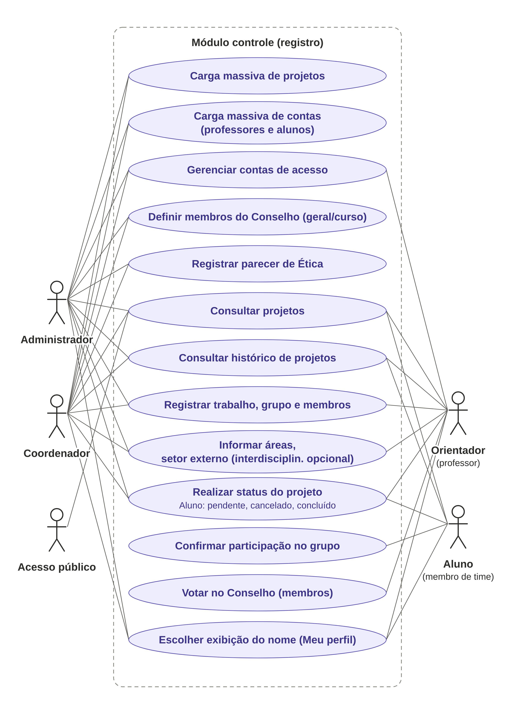

# Diagrama de Caso de Uso: Módulo 2 Controle (Registro)

Versão vetorial: [caso-de-uso.svg](caso-de-uso.svg)

## Atores

| Ator | Funcionalidades |
|---|---|
| Administrador | Carga massiva de projetos e de contas; gerenciar todas as contas; definir os membros do Conselho; registrar o parecer de Ética; registrar projetos; consultar projetos e o histórico completo, com RA e nome completo; realizar qualquer status, inclusive Avaliado, e reabrir projetos finalizados |
| Coordenador | Carga massiva de projetos e de contas (sem criar coordenadores); gerenciar contas de orientadores e alunos; definir os membros do Conselho; registrar o parecer de Ética; registrar projetos; consultar projetos e o histórico completo, com RA e nome completo; realizar qualquer status, inclusive Avaliado, e reabrir projetos finalizados |
| Orientador (professor) | Cadastrar trabalhos (CRUD) e informar áreas de atuação, interdisciplinaridade e setor externo; criar contas de alunos; votar no Conselho quando for membro, com comentário; consultar projetos e o histórico completo, com RA e nome completo; realizar os status dos projetos em que é o responsável (exceto Avaliado) |
| Aluno (membro de time) | Confirmar ou recusar participação no grupo; realizar os status Pendente, Cancelado e Concluído nos projetos em que está confirmado; escolher como o nome é exibido (Meu perfil); consultar os projetos publicados e o histórico dos projetos em que participa ou participou, sem ver RA de ninguém |
| Acesso público | Consulta de informações dos projetos publicados, sem RA e com os nomes conforme a preferência de cada aluno |

## Fluxo resumido de uso

Orientador registra o projeto → informa áreas, interdisciplinaridade e setor externo → adiciona grupo e membros → alunos confirmam participação → comitê de ética avalia fora do sistema e a coordenação registra o parecer de Ética → membros do Conselho votam com o próprio login → com os dois pareceres aprovados, o projeto vai para Desenvolvimento → orientador e alunos acompanham e realizam status → ao final, a coordenação registra Avaliado, ou o projeto é Finalizado e segue consultável no histórico.
