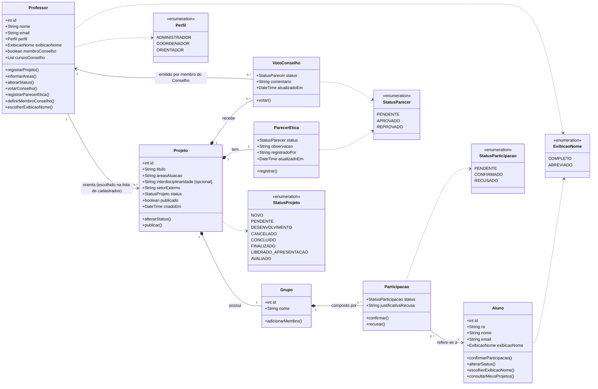

# Diagrama de Classes: Módulo 2 Controle (Registro)

Imagem: [diagrama-classes.png](diagrama-classes.png)

## Entidades

| Entidade | Papel no módulo |
|---|---|
| Projeto | Trabalho extensionista registrado pelo orientador, com áreas de atuação, interdisciplinaridade, setor externo, status, publicação e data de criação |
| Professor | Orientador, Coordenador ou Administrador; o atributo perfil indica qual. Orientadores incluídos no Conselho geral (membroConselho) votam em todos os projetos; os incluídos no Conselho de um curso (cursosConselho) votam só nos projetos com alunos desse curso. Também escolhe como o nome é exibido (exibicaoNome); o nome completo continua gravado |
| Grupo | Time vinculado ao projeto |
| Aluno | Membro de time. Escolhe como o nome é exibido (exibicaoNome); o RA não pode ser alterado |
| Participacao | Vínculo entre aluno e grupo, com o status (pendente, confirmado ou recusado) e a justificativa de recusa. É preservado mesmo depois de o projeto ser finalizado |
| ParecerEtica | Decisão de Ética sobre o projeto, registrada por Coordenador ou Administrador após avaliação feita fora do sistema |
| VotoConselho | Voto individual de um orientador membro do Conselho sobre um projeto, com comentário. Cada orientador só registra o próprio voto |

## Regras de negócio relacionadas

- O parecer do Conselho é calculado a partir dos votos: **Aprovado** quando mais da metade dos membros aprova, **Reprovado** quando a aprovação deixa de ser possível e **Pendente** nos demais casos.
- O Conselho de um projeto reúne os membros gerais e os membros do curso de cada aluno do grupo; a interdisciplinaridade é opcional.
- O projeto só pode ir para Desenvolvimento com Ética e Conselho aprovados.
- A exibição do nome é escolhida por cada pessoa (Aluno, Orientador, Coordenador e Administrador) e vale para todos os perfis nas telas de consulta, inclusive para a própria pessoa. O nome completo e o RA aparecem apenas para a gestão em formulários de criar e editar projeto, na exportação CSV e em Gerenciar Contas; público e alunos nunca recebem o RA.
- O orientador responsável de um projeto é escolhido entre as contas de Orientador e Coordenador cadastradas, tanto no formulário quanto na carga massiva; um nome que não corresponde a uma conta é recusado (ignorado na carga massiva).
- Projetos finalizados não são apagados: saem da listagem principal e continuam na pesquisa e no histórico.

## Observação

Os atributos refletem o sistema atual e poderão ser refinados nas próximas etapas.
