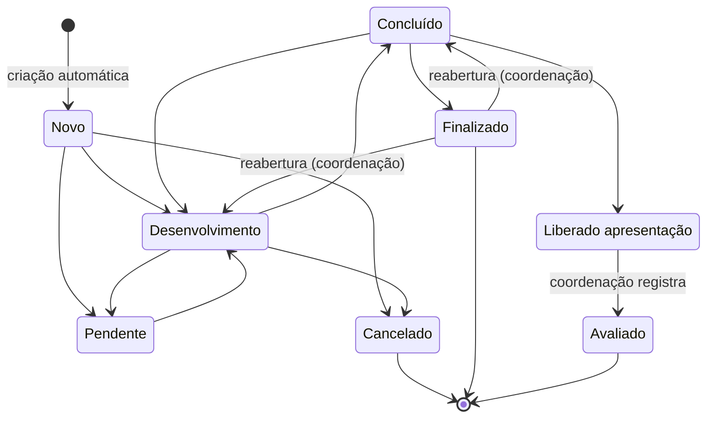

# Diagrama de Estados: Projeto (Módulo 2 Controle)

Imagem: [diagrama-estados.png](diagrama-estados.png)

## Estados finais

Cancelado, Finalizado e Avaliado. Cancelado e Avaliado não aceitam nova mudança de estado. O Finalizado só pode ser reaberto pela Coordenação ou pelo Administrador (veja as regras).

## Quem realiza cada estado

| Estado | Orientador responsável, Coordenador e Administrador | Aluno confirmado no grupo | Condição |
|---|---|---|---|
| Novo | Automático | Automático | Criação do projeto |
| Pendente | Sim | Sim | A partir de Novo ou Desenvolvimento |
| Desenvolvimento | Sim | Não | Pareceres de Ética **e** do Conselho aprovados |
| Cancelado | Sim | Sim | A partir de Novo ou Desenvolvimento |
| Concluído | Sim | Sim | A partir de Desenvolvimento |
| Finalizado | Sim | Não | A partir de Concluído |
| Reabertura de Finalizado (para Concluído ou Desenvolvimento) | Somente Coordenador e Administrador | Não | Corrige finalizações feitas por engano; não exige novos pareceres |
| Liberado apresentação | Sim | Não | A partir de Concluído |
| Avaliado | Somente Coordenador e Administrador | Não | A partir de Liberado apresentação, após a avaliação na mostra |

## Regras

- O orientador só altera os projetos em que consta como responsável; Coordenador e Administrador alteram todos.
- O aluno só altera o estado dos projetos em que sua participação está **confirmada**, e apenas para Pendente, Cancelado ou Concluído.
- Qualquer mudança para Desenvolvimento, inclusive o retorno a partir de Concluído, exige os pareceres de Ética e do Conselho aprovados ([atividades 05 a 07](../atividades/diagramas-atividade.md)). A reabertura de um projeto Finalizado é exceção: os pareceres já foram aprovados antes de o projeto entrar em Desenvolvimento.
- Projetos Finalizados saem da listagem principal, mas continuam disponíveis na pesquisa e no histórico. Nenhum projeto é apagado ao mudar de estado.
- Projetos antigos no estado "Em andamento" foram convertidos para Desenvolvimento.
